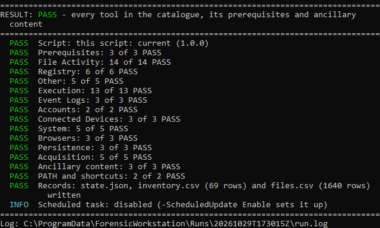

# forensic-workstation

My own set-up of the common Windows forensic tools, shared as it is: one
Windows PowerShell script that installs them on a fresh DFIR workstation and
keeps them current, downloading only what has changed since the last run and
removing what is no longer needed.

It isn't a forensic suite. It keeps the many small standalone tools up to
date, so the workstation is ready before an investigation: Eric Zimmerman's
tools (EZ Tools) with their EvtxECmd maps, RECmd batch files and SQLECmd
maps, NirSoft's forensic utilities, Sysinternals tools and Arsenal Image
Mounter with its driver, with the .NET runtimes and Visual C++
Redistributable they need. Every download is hashed, checked against the
vendor's published hash and signer, and recorded, so the tool versions
behind an analysis can be cited later.

The selection is mine. Use it as it is, or adapt it: adding or
dropping a tool is a row in a table, and another vendor's set needs only a
small function that finds its downloads (see [Adapting it](#adapting-it)).


An update with two tools and the EvtxECmd maps due, typed at a Windows
PowerShell prompt (in Windows Sandbox), in real time; the last frame is held
for four seconds.

## Table of contents

- [What it does](#what-it-does)
- [Install](#install)
- [Usage](#usage)
- [The catalogue](#the-catalogue)
- [Adapting it](#adapting-it)
- [Where things go](#where-things-go)
- [What the output shows](#what-the-output-shows)
- [What it does not do](#what-it-does-not-do)
- [Contributing](#contributing)
- [Licence](#licence)

## What it does

- Installs every tool in its catalogue, or updates those whose source has
  changed: each source's change marker (HTTP headers, a release tag, a
  version) is compared with the one recorded at install, so an unchanged tool
  is never downloaded again.
- Picks each tool's newest build: x64 over x86, the newest .NET line the
  vendor offers.
- Installs the runtimes those builds need, and only those: each .NET runtime
  line a tool targets (the Desktop Runtime only where a GUI tool needs it,
  since it covers the plain runtime of its line). Each line is kept at its
  latest patch; .NET 9 and .NET 10 are separate lines.
- Checks EvtxECmd's maps, RECmd's batch files and SQLECmd's maps on every run
  by the last commit to their folder upstream, and runs the tool's own
  `--sync` when it has changed. Files retired upstream are removed (`--sync`
  alone keeps them).
- Verifies every download: SHA-256, the vendor's published hash where there
  is one (.NET, Arsenal Image Mounter, the Visual C++ Redistributable, AIM's
  driver package), the Authenticode signer of every exe it installs, AIM's
  driver against its Microsoft-signed catalogue, and a
  re-read of every extracted file before it is used. An update is swapped in
  only when all of that passes; a tool running from its folder is left as it
  is.
- Puts command-line tools on the machine PATH, so they run by name from any
  terminal, and GUI tools on the Desktop and in the Start Menu, in a folder
  per family with several (Timeline Explorer and Arsenal Image Mounter
  directly).
- Removes what it installed and no longer needs: tools dropped from the
  catalogue, superseded prerequisite versions, runtime lines no tool needs.
  It never removes anything it didn't install.
- Writes a log per run, and an inventory and per-file SHA-256 record of what
  is installed.

## Install

```powershell
# Download Update-ForensicWorkstation.ps1 from the latest release, then:
Get-FileHash .\Update-ForensicWorkstation.ps1 -Algorithm SHA256
# compare with the SHA-256 in the release notes
Unblock-File .\Update-ForensicWorkstation.ps1
```

### Requirements

- 64-bit Windows (amd64), Windows PowerShell 5.1, no modules. Tested on
  Windows 11 24H2; not tested on Windows 10.
- An elevated prompt for an update; `-CheckOnly` and `-Verify` run without.
- Internet access to the vendors' download sites, GitHub (the maps) and
  Microsoft's .NET release metadata, through the account's system proxy
  settings.

## Usage

```powershell
# Install or update everything (elevated):
.\Update-ForensicWorkstation.ps1

# Is the workstation current? Lists what an update would do, changes nothing:
.\Update-ForensicWorkstation.ps1 -CheckOnly

# Only some families or tools (nothing is removed in a selective run):
.\Update-ForensicWorkstation.ps1 -Family Zimmerman
.\Update-ForensicWorkstation.ps1 -Tool EvtxECmd, ProcessExplorer

# Re-hash every installed file against the record:
.\Update-ForensicWorkstation.ps1 -Verify
```

| Parameter | Effect |
|---|---|
| `-CheckOnly` | The dry run: every source is checked and every action an update would take is listed; nothing changes. `-WhatIf` does the same. |
| `-Verify` | Re-hashes the installed files against `files.csv` and lists files missing, changed or not on record. No network access. |
| `-Family` | Limits the run to these families: `Zimmerman`, `NirSoft`, `Sysinternals`, `Arsenal`. |
| `-Tool` | Limits the run to these tools (names as in the catalogue). |

Exit codes: 0 PASS, 1 WARN, 2 FAIL, 3 stopped before any work.

## The catalogue

| Family | Tools | Source |
|---|---|---|
| Zimmerman | GUI: JumpList Explorer, MFT Explorer, Registry Explorer, SDB Explorer, ShellBags Explorer, Timeline Explorer. CLI: AmcacheParser, AppCompatCacheParser, EvtxECmd, JLECmd, LECmd, MFTECmd, PECmd, RBCmd, RecentFileCacheParser, RECmd, SBECmd, SQLECmd, SrumECmd, SumECmd, WxTCmd | download.ericzimmermanstools.com |
| NirSoft | AppCompatibilityView, AppResourcesUsageView, FullEventLogView, JumpListsView, OfflineRegistryFinder, OfflineRegistryView, RecentFilesView, ShellBagsView, ShortcutsMan, USBDeview, UserAssistView, WinPrefetchView | nirsoft.net |
| Sysinternals | Autoruns (and autorunsc), Disk2vhd, Process Explorer | download.sysinternals.com |
| Arsenal | Arsenal Image Mounter (GUI, and `aim_cli`, `aim_pro`) | arsenalrecon.com: version and MD5; the zip downloaded by hand (MEGA) |

Zimmerman tools are those of the vendor's "Forensic tools" section with a
build on a current .NET line, all .NET 10 today; Hasher, bstrings, rla, EZ
Viewer and VSCMount are not included. A
tool the vendor adds is reported as available, not installed, until it is in
the catalogue. Five of the NirSoft tools have no x64 build and are installed
as x86.

| Prerequisite | When | Source |
|---|---|---|
| .NET Desktop Runtime, per major version | a GUI tool targets that version | Microsoft's release metadata (SHA-512) |
| .NET Runtime, per major version | only CLI tools target that version | Microsoft's release metadata (SHA-512) |

A runtime version something else installed is used, and listed in the
inventory as not installed by the script; it is never removed.

**Arsenal Image Mounter** is installed like the others, except that you
download it: its vendor ships it through MEGA. When an install or update is
due, the run says which zip to download from the vendor's downloads page
into your Downloads folder; the next run checks it against the vendor's MD5
and signer and installs the GUI (a Desktop shortcut) and the command-line
`aim_cli` and `aim_pro` (on the PATH), with the .NET Desktop Runtime 10, the
Visual C++ Redistributable (x64) and AIM's driver (Arsenal's package from
GitHub: its catalogue must be signed by Microsoft's hardware compatibility
publisher and name every driver file, verified by Windows' own verifier,
then installed with their `aim_ll.exe`). Visual C++ and the driver are
kept current and never removed: other programs share Visual C++, and
removing the driver needs a restart.

## Adapting it

Everything specific to a tool or vendor sits in tables at the top of the
script (CONFIG), each field documented beside it; the rest is shared.

| To | Change |
|---|---|
| Add a Zimmerman tool left out | Take its zip out of `$EzOutOfScope` and add a `$Catalogue` row, copied from a similar tool's |
| Drop a tool | Remove its `$Catalogue` row: the next full run removes it from the workstation, with its PATH entry and shortcuts |
| Add a NirSoft tool | A `$Catalogue` row; `Package` is the name in its PAD and zip URLs, the x64 build is picked when there is one (`$NirSoftBuilds`) |
| Add a Sysinternals tool | A `$Catalogue` row; `Package` is the zip's name, `Files` its x64 files, `EulaKeys` its key under `HKCU\Software\Sysinternals` |
| Add another vendor's set | A `$Families` row (its signer), its `$Catalogue` rows, and a source adapter: a function `Get-<Source>Remote` that returns `New-Remote` (where the current file is, a change marker, the vendor's hash if it publishes one), with its line in `Get-ToolRemote` |
| Add a .NET runtime flavour, or maps synced like EvtxECmd's | A row of `$DotNetFlavours` or `$AncillaryContent` |

An adapter only says what is current and where to get it. Downloading, the
hash and signer checks, extraction, the install and swap, PATH, shortcuts,
writable folders, clean-up and the records are shared by every source.
`Get-SysinternalsRemote`, seven lines, is the simplest adapter to start
from.

## Where things go

| What | Where |
|---|---|
| Tools | `%ProgramFiles%\ForensicTools\<Family>\<Tool>\` |
| CLI tools | each one's folder on the machine PATH |
| GUI shortcuts | Desktop and Start Menu, in a folder per family (`EZ Tools`, `NirSoft`, `Sysinternals`); Timeline Explorer and Arsenal Image Mounter directly |
| Records | `%ProgramData%\ForensicWorkstation\`, writable by administrators only |
| Kept installers | `%ProgramData%\ForensicWorkstation\Installers\`, for a later uninstall |

Program Files is used because only elevated processes write there: a folder on
the PATH that a standard process could write to would let it replace a binary
that later runs elevated. The account may write only to the settings the
tools save beside their exe, and nothing else in their folders: each NirSoft
tool's `.cfg` file, Registry Explorer's `Bookmarks\User`, ShellBags
Explorer's and Timeline Explorer's `Settings`, ShellBags Explorer's `logs`,
JumpList Explorer's and SDB Explorer's `Settings.xml`, and the `Temp` folder
where
AmcacheParser, SQLECmd, SrumECmd, SumECmd and WxTCmd copy the databases
they read. A tool folder on the PATH is never writable; only a subfolder
of it may be. These are kept across updates and are not verified. Only the
x64 builds of the Sysinternals tools are installed; autorunsc has a folder of
its own, so `autorunsc64` is on the PATH and the Autoruns GUI is not.


*The Desktop after a fresh build: a folder per family, the two tools used
with every family directly.*

## What the output shows

Each run writes `Runs\<UTC time>\run.log` under the records folder (a dry run
or `-Verify` without elevation writes under `%LocalAppData%` instead). An
update also writes, at the records folder's root and in the run's folder:

| File | Holds |
|---|---|
| `inventory.csv` | Per tool, prerequisite version and ancillary set: version, build, whether the script installed it, source URL, SHA-256 of the download, the vendor's hash and whether it matched, the signer, the change marker, the install time (UTC), the location |
| `files.csv` | The SHA-256 of every file the script installed, vendor files and synced content apart |
| `state.json` | What the script installed and owns (what clean-up may remove) |


*`inventory.csv` in Timeline Explorer (first columns).*

Records are UTF-8 without BOM, CRLF, every CSV cell quoted. The console ends
with a result block: PASS (current and verified), WARN (an update not applied,
a source that couldn't be checked, a tool in use, a runtime past its end of
support), FAIL (an install or a check that failed), per family and for
prerequisites, ancillary content, PATH and shortcuts, clean-up and records.



*The result block: the verdict and each group.*

The records show what was installed, from where, with which hashes, and when,
and `-Verify` shows whether the files are still those bytes. They don't show
how a tool was used, and they say nothing about a file changed or replaced by
anything else between runs beyond what `-Verify` finds.

## What it does not do

- It isn't a forensic suite: it installs and updates a chosen set of
  standalone tools, and nothing it doesn't list.
- It installs nothing for other accounts on the machine: per-user items
  (shortcuts, the Sysinternals EULA) are for the account that runs it.
- It doesn't keep custom EvtxECmd or SQLECmd maps or RECmd batch files across
  a sync.
- No scheduled runs, no Microsoft Defender exclusions and no self-update yet.
- It doesn't download Arsenal Image Mounter (you do; see the catalogue).
- It never removes the Visual C++ Redistributable or AIM's driver; Windows'
  driver store keeps each AIM driver package installed.
- MemProcFS and KAPE are not in the catalogue.
- arm64 Windows is not supported.

## Contributing

Questions and bug reports: GitHub issues. Pull requests are welcome.

Adding tools and sources: see [Adapting it](#adapting-it).
Code: Windows PowerShell 5.1, no modules, PSScriptAnalyzer-clean, ASCII.

## Licence

[0BSD](LICENSE) (Zero-Clause BSD). Copyright (C) 2026 by outis.
Use it for anything, with no attribution required; provided as is, with no
warranty.
